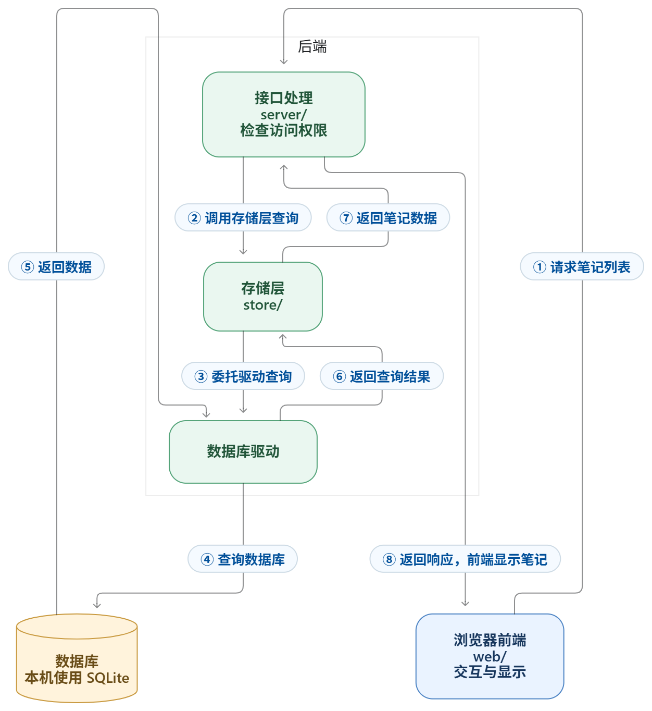

# 03 现状分析

## 3.1 分层结构

| 层 | 位置 | 职责 |
|---|---|---|
| 表现层 | `web/` | React + TypeScript，编辑器、时间线、标签栏 |
| 接口层 | `server/` + `proto/` | ConnectRPC 接口，校验身份、限流、解析标签 |
| 存储层 | `store/` | 业务存储抽象，屏蔽底层差异 |
| 驱动层 | `store/db/sqlite` 等 | SQL 执行与事务 |
| 数据层 | SQLite `memos_prod.db` | 笔记、账号、附件元数据 |



## 3.2 目录与代码组织

```
web/      前端（React + TS），编辑器、时间线、标签组件
server/   后端服务与 RPC 实现
proto/    接口定义（protobuf）
store/    存储层与数据库驱动
```

## 3.3 核心业务流程：发布一条笔记

| 步骤 | 谁在做 | 做了什么 | 结果 |
|---|---|---|---|
| 1 | 用户 | 输入正文、选择可见性 | 草稿 |
| 2 | 前端 | 打包成一次 CreateMemo 请求 | 请求就绪 |
| 3 | 网络 | 发到 `/memos.api.v1.MemoService/CreateMemo` | 服务端收到 |
| 4 | 服务端 | 身份校验、限流、生成 uid、解析 `#标签` | 规则处理完 |
| 5 | 数据库 | memo 表新增一行 | 落盘 |
| 6 | 前端 | 渲染到时间线顶部 | 用户看到成功 |

**证据**：请求体 45 字节、二进制 protobuf（对应 `web/src/connect.ts` 的 `useBinaryFormat: true`）；
数据库中 `payload` 字段已含 `tags: ["软件工程","流程验证"]`，说明标签是服务端解析后结构化的。

## 3.4 数据模型

- 笔记正文与可见性存 `memo` 表；
- 附件文件单独存放，数据库只记文件名、路径与所属笔记；
- 因此**只备份数据库会漏掉附件**——这是 MNT-06 的直接来源。

## 3.5 质量保障机制

| 机制 | 位置 |
|---|---|
| 后端检查与测试 | `.github/workflows/backend-tests.yml`（分组跑 `go test`，部分带 `-race`） |
| 前端检查 | `frontend-tests.yml` + `web/package.json` 的 lint / test / build |
| 协议检查 | `proto-linter.yml` |
| 发布前验证 | `release.yml` 调用 `upgrade-smoke.yml`（全新安装、旧版升级、迁移） |
| 漏洞反馈 | `SECURITY.md`（私下报告、仅最新版本修复） |

> 纪律：**配置存在不等于有效**。这些工作流是否真的跑过、有没有跳过项，属于第四阶段
> 线索 10—12 的验证范围，对应 [MNT-07](../mnt/MNT-07.md)。
